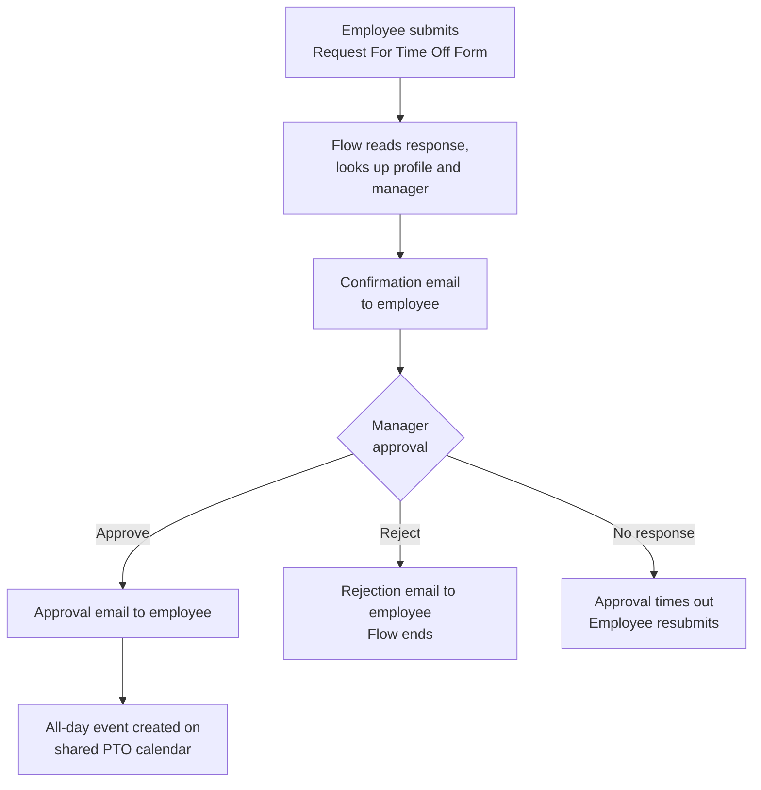

# PTO Request Automation (Microsoft 365)

A low-code, low-cost paid-time-off workflow created to improve upon legacy PTO workflow: employees request time off in **Microsoft Forms**, **Power Automate** routes the request to their manager for approval, and approved requests become all-day events on a shared **Outlook** calendar.

> **Template notice:** This is a sanitized template of a workflow running in production. Organization names, domains, mailboxes and accounts have been replaced with placeholders (`example.com`). See [Adapting this template](#adapting-this-template).

# How it works



# Stack

| Component | Role |
|---|---|
| Microsoft Forms | The request form employees fill in |
| Power Automate (cloud, Modern Designer) | Workflow and approval logic |
| Outlook / Microsoft Graph | Creates the calendar event |
| Shared mailbox + service account | Sends notifications and holds calendar access |

# Design decisions

**Exclusive end date (+1 day).** Outlook all-day events treat the end date as exclusive: it marks where the event stops and isn't shown. The flow adds one day to the requested End Date so the event covers exactly the requested range without adding a visible extra day.

**Empty End Date fallback.** For single-day requests, Forms may return no End Date. The flow uses `coalesce()` to fall back to the Start Date rather than failing.

```
addDays(
  coalesce(
    triggerOutputs()?['body/EndDate'],
    triggerOutputs()?['body/StartDate']
  ),
  1
)
```

**Identity from the signed-in account.** Employee name and email come from the work account used to submit the form, so they can't be mistyped or spoofed.

**No automatic retry.** Failed runs are never retried. Every known failure ends with the employee resubmitting, which avoids duplicate calendar events from blind re-runs.

**Dedicated service account.** Notifications and calendar writes run under a dedicated automation account with delegated mailbox access and Editor rights on the shared calendar, not under an individual's account.

# Limits by design

These are intentional scope decisions, not defects:

- Full-day PTO only (half-day and hourly are edited/handled manually by HR)
- No PTO balance checks
- No overlap detection between employees
- No past-dated PTO

# Documentation

- [Runbook](docs/runbook.md) covers how the flow works, failure handling and safe changes.
- [Manager guide](docs/manager-guide.md) covers how managers approve, reject and review requests.
- [Changelog](CHANGELOG.md)

# Adapting this template

Replace these placeholders with your own values:

| Example | Meaning |
|---|---|
| `example.com` | Your organization's email domain |
| `pto-calendar@example.com` | Shared mailbox that owns the PTO calendar |
| `svc-automation@example.com` | Dedicated service account that runs notifications and calendar writes |
| Local Time Zone | Time zone set in **Create event (V4)** |

Before going live, run the required tests in the [runbook](docs/runbook.md#required-tests-after-any-change).
