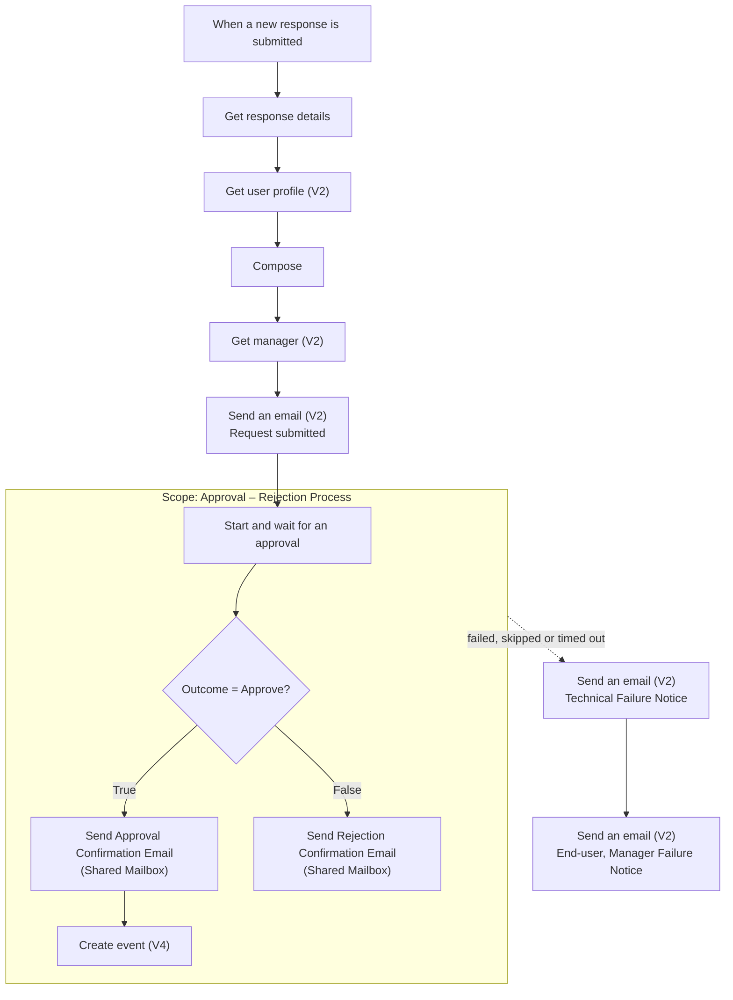

# Power Automate: PTO Request Flow

This flow takes each new form response, routes it to the employee's manager for approval, emails the outcome, and creates an all-day event on the shared PTO calendar for approved requests. Build the form first (see [`forms/`](../forms/)).

---

# Prerequisites

> **Create the flow while signed in as the service account** (`svc-automation@example.com`), not a personal account.
> The form must be owned by the same account. This keeps the trigger connected to the form and keeps the process running when individual employees leave.

# Connections

Every connection should sign in as the service account.

| Connector | Used for |
|---|---|
| Microsoft Forms | Trigger and reading responses |
| Office 365 Users | Looking up the employee's profile and manager |
| Approvals | Sending the approval request to the manager |
| Office 365 Outlook | Notification emails and the calendar event |

**Licensing:** all four are standard connectors, so no premium Power Automate license is required.

---

# Flow structure

# Diagram



The diagram leaves out the For each loops around the approval and rejection emails. The outline below shows the exact nesting as it appears in the designer.

# Outline

```
When a new response is submitted
Get response details
Get user profile (V2)
Compose
Get manager (V2)
Send an email (V2) – Informs employee their request has been submitted
Scope: Approval – Rejection Process
├── Start and wait for an approval
└── Condition (approved?)
    ├── True
    │   ├── For each 1
    │   │   └── Send Approval Confirmation Email (Shared Mailbox)
    │   └── Create event (V4)
    └── False
        └── For each
            └── Send Rejection Confirmation Email (Shared Mailbox)
Send an email (V2) – Technical Failure Notice      ← runs only if something fails
Send an email (V2) – End-user, Manager Failure Notice
```

# Step-by-step

# 1. When a new response is submitted *(Microsoft Forms)*

| Setting | Value |
|---|---|
| Form Id | Request For Time Off Form |

# 2. Get response details *(Microsoft Forms)*

| Setting | Value |
|---|---|
| Form Id | Request For Time Off Form |
| Response Id | `Response Id` (dynamic content from the trigger) |

Returns the form answers, the responder's email and the Submission Time.

# 3. Get user profile (V2) *(Office 365 Users)*

| Setting | Value |
|---|---|
| User (UPN) | `Responder's Email` |

Returns the employee's display name and profile details for the emails.

# 4. Compose *(Data Operation)*

<!-- TODO: Describe what this Compose builds and paste its input. -->

# 5. Get manager (V2) *(Office 365 Users)*

| Setting | Value |
|---|---|
| User (UPN) | `Responder's Email` |

Returns the employee's manager, who becomes the approver. **If the employee has no manager assigned in Microsoft 365, the flow fails here** (see [When the flow fails](../docs/runbook.md#4-when-the-flow-fails)).

# 6. Send an email (V2): request submitted *(Office 365 Outlook)*

| Setting | Value |
|---|---|
| To | `Responder's Email` |
| Subject | <!-- TODO --> |
| Body | Confirms the request was received, and includes the request details and the employee's manager. |

---

# 7. Scope: Approval – Rejection Process

A Scope groups the approval and its outcomes into one block. If anything inside it fails or times out, the whole Scope fails, so the error-handling emails after it need only one **Configure run after** setting to catch every failure.

# 7a. Start and wait for an approval *(Approvals)*

| Setting | Value |
|---|---|
| Approval type | <!-- TODO: e.g. Approve/Reject – First to respond --> |
| Title | <!-- TODO --> |
| Assigned to | `Mail` (dynamic content from Get manager (V2)) |
| Details | <!-- TODO: request details shown to the manager --> |
| Timeout (Settings tab) | <!-- TODO --> |

The run waits here until the manager responds or the approval times out.

# 7b. Condition

| Left value | Operator | Right value |
|---|---|---|
| `Outcome` (from the approval) | is equal to | `Approve` |

<!-- TODO: Confirm the condition values. -->

# True branch: approved

**For each 1 → Send Approval Confirmation Email (Shared Mailbox)**

| Setting | Value |
|---|---|
| From (shared mailbox) | `pto-calendar@example.com` |
| To | `Responder's Email` |
| Subject | <!-- TODO --> |
| Body | Confirms the approval, with the request and manager details. |

> **Why the For each?** The approval's `Responses` output is a list, one entry per approver. When you add dynamic content from it (like the approver's comments), Power Automate wraps the action in a For each automatically. With a single approver it runs once.

**Create event (V4)**

| Setting | Value |
|---|---|
| Calendar id | The `pto-calendar@example.com` calendar |
| Subject | Includes the employee's name and PTO reason <!-- TODO: paste the exact subject --> |
| Start time | `Start Date` from the form |
| End time | Expression below (End Date + 1 day) |
| Time zone | (UTC-06:00) Central Time (US & Canada) |
| Is all day event | Yes |

```
addDays(
  coalesce(
    triggerOutputs()?['body/EndDate'],
    triggerOutputs()?['body/StartDate']
  ),
  1
)
```

Outlook all-day events use an exclusive end date, so the flow adds one day. See [the +1 day rule](../docs/runbook.md#calendar-end-date-the-1-day-rule).

# False branch: rejected

**For each → Send Rejection Confirmation Email (Shared Mailbox)**

| Setting | Value |
|---|---|
| From (shared mailbox) | `pto-calendar@example.com` |
| To | `Responder's Email` |
| Subject | <!-- TODO --> |
| Body | Confirms the rejection, with the request and manager details. |

No calendar event is created.

---

# Error handling

These two actions sit after the Scope and run only when something goes wrong.

# 8. Send an email (V2): Technical Failure Notice

| Setting | Value |
|---|---|
| Configure run after | Scope: **has failed**, **is skipped**, **has timed out** <!-- TODO: confirm --> |
| To | IT and HR |
| Body | Employee name, employee email, Submission Time and flow name |

"Is skipped" matters: if an action *before* the Scope fails (for example Get manager (V2)), the Scope is skipped rather than failed, and this setting still catches it.

# 9. Send an email (V2): End-user, Manager Failure Notice

| Setting | Value |
|---|---|
| Configure run after | Technical Failure Notice: **is successful** (default) |
| To | The employee and their manager |
| Body | <!-- TODO: what the employee and manager are told --> |

Because it follows the Technical Failure Notice, it only runs when that one does.

---

# Expressions reference

| Where | Expression | Purpose |
|---|---|---|
| Create event (V4) → End time | `addDays(coalesce(triggerOutputs()?['body/EndDate'], triggerOutputs()?['body/StartDate']), 1)` | Exclusive end date, with fallback for single-day PTO |

<!-- TODO: Add the Compose input and any subject-line expressions. -->

---

# After building

Run all of the [required tests](../docs/runbook.md#required-tests-after-any-change) with a test user account before turning the flow on in production.
